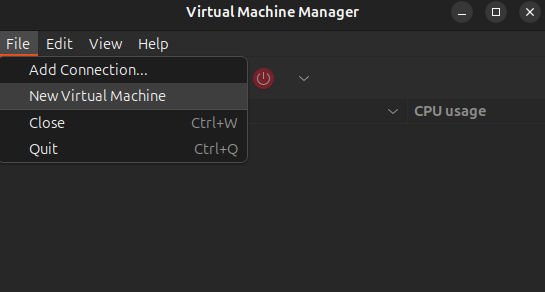
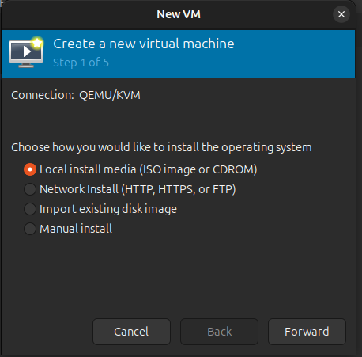
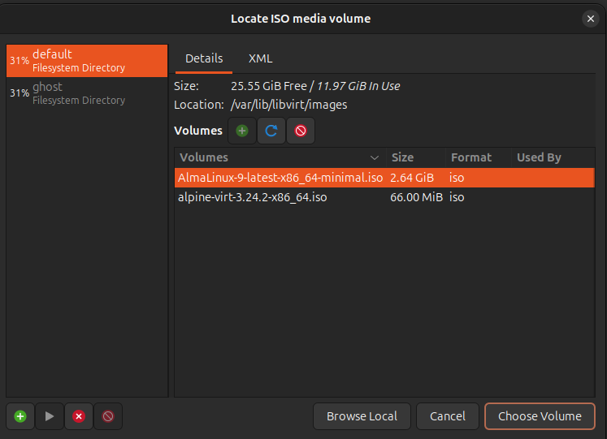
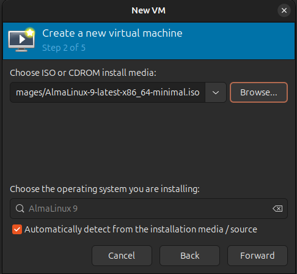
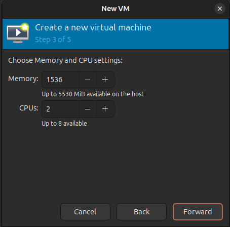
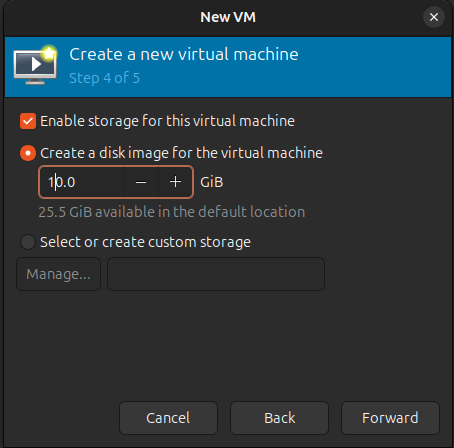
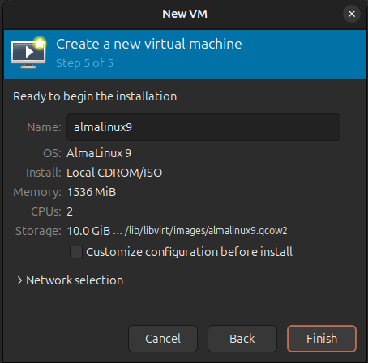
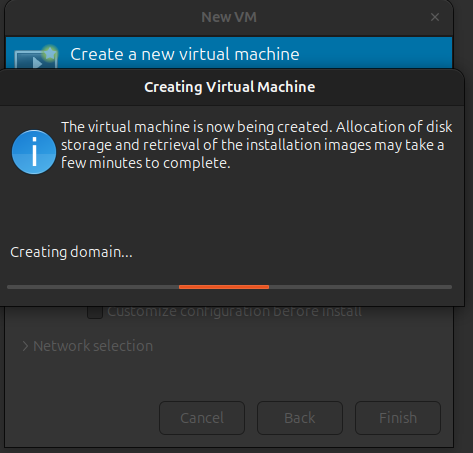
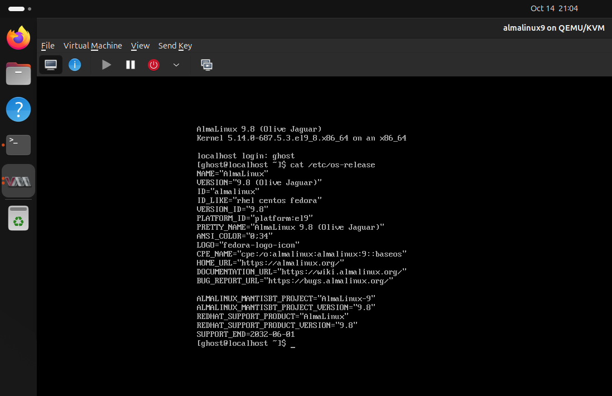

# KVM/QEMU Setup on Ubuntu

Run virtual machines on Ubuntu with KVM, QEMU and libvirt, using either the GUI (virt-manager) or the CLI (virt-install).

## Host requirements

| Resource | Value |
|----------|-------|
| RAM      | 6 GB  |
| Disk     | 40 GB |
| CPU      | Intel VT-x or AMD-V enabled in BIOS/UEFI |

Enable **Intel VT-x** (Intel) or **SVM / AMD-V** (AMD) in the processor settings of your BIOS/UEFI. If the Ubuntu host is itself a VM, enable nested virtualization / expose VT-x/AMD-V to it.

Guest VMs must fit inside the host's free resources (virt-manager shows what is available while you pick memory, CPUs and disk).

## 1. Check hardware virtualization support

```bash
sudo apt install -y cpu-checker
kvm-ok
```

Expected output:

```
INFO: /dev/kvm exists
KVM acceleration can be used
```

Count the virtualization-capable CPU threads:

```bash
egrep -c '(vmx|svm)' /proc/cpuinfo
```

A result greater than `0` means KVM can work (example: `16`).

## 2. Install packages

```bash
sudo apt install -y qemu-kvm libvirt-daemon-system libvirt-clients bridge-utils virtinst virt-manager
```

Add your user to the `kvm` and `libvirt` groups:

```bash
sudo adduser $USER kvm
sudo adduser $USER libvirt
```

Log out and back in (or run `newgrp libvirt`) so the group changes take effect.

Verify the libvirt service is running:

```bash
systemctl status libvirtd
```

## 3. Create a VM

You can use either the GUI or the CLI. Launch the GUI from a terminal with `virt-manager`, or open **Virtual Machine Manager** from the applications menu.

### Option A: GUI (virt-manager)

Example: AlmaLinux 9 minimal ISO. Copy the ISO to `/var/lib/libvirt/images/` first so it shows up in the default storage pool.

**Step 1.** In Virtual Machine Manager, open **File > New Virtual Machine**.



**Step 2.** (1/5) Choose **Local install media (ISO image or CDROM)**, then click **Forward**.



**Step 3.** (2/5) Click **Browse...**, pick the ISO from the `default` pool (`/var/lib/libvirt/images`), then click **Choose Volume**.



**Step 4.** The ISO path is filled in and the OS is auto-detected (AlmaLinux 9). Click **Forward**.



**Step 5.** (3/5) Set memory and CPUs (here 1536 MiB and 2 CPUs, within what the host has available).



**Step 6.** (4/5) Keep **Enable storage** checked and set the disk size (here 10 GiB).



**Step 7.** (5/5) Review the summary, set the VM name (`almalinux9`), and click **Finish**. Tick **Customize configuration before install** if you want to tweak hardware first.



**Step 8.** Wait while libvirt creates the domain and allocates the disk.



**Step 9.** Complete the OS installation. The VM now boots and you can log in (check with `cat /etc/os-release`).



### Option B: CLI (virt-install)

Example: create a small Alpine VM.

```bash
virt-install \
  --name=alpine-cli \
  --ram=1024 \
  --vcpus=2 \
  --disk path=/var/lib/libvirt/images/alpine-cli.qcow2,size=4 \
  --os-variant=alpinelinux3.21 \
  --cdrom=/var/lib/libvirt/images/alpine-virt-3.24.2-x86_64.iso \
  --network network=default \
  --graphics vnc
```

To find valid `--os-variant` values:

```bash
osinfo-query os
```

## 4. Manage VMs

| Command | Action |
|---------|--------|
| `virsh list` | List running VMs |
| `virsh list --all` | List all VMs, including stopped |
| `virsh start <name>` | Start a VM |
| `virsh shutdown <name>` | Graceful shutdown |
| `virsh destroy <name or id>` | Force power-off (does **not** delete the VM) |
| `virsh undefine <name> --remove-all-storage` | Delete the VM and its disks |

## 5. Last resort: kill the QEMU process

If a VM is completely frozen and `virsh destroy` fails, kill the QEMU process directly from the OS (not through KVM).

Find the PID:

```bash
cat /run/libvirt/qemu/<name>.pid
```

Kill it:

```bash
sudo kill -9 <vm-pid>
```

This is an unclean stop, so use it only when nothing else works.